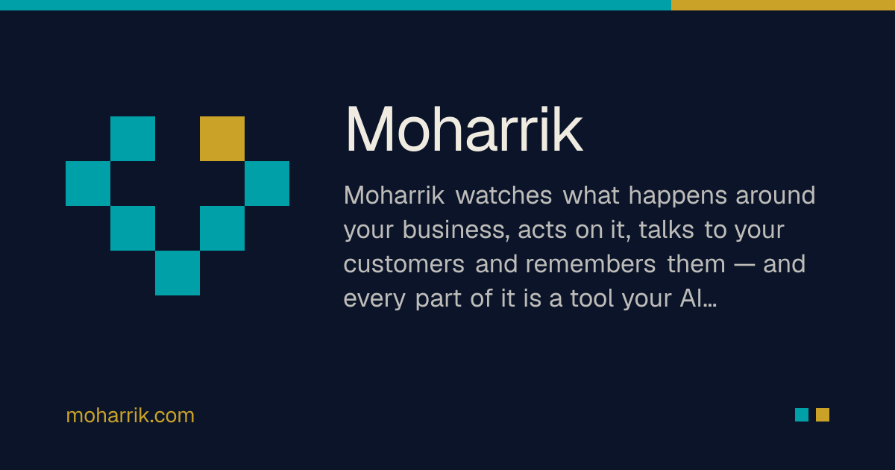

<div align="center">



# Moharrik — محرّك

**The open-source AI engine behind a business: connect your channels and accounts, and Moharrik watches (notifications, trends, research), acts (automation), talks to customers (chat, email, WhatsApp) and remembers them (CRM). Every capability is an MCP tool, so your AI agents can do it too.**

[](https://to-go.dev)
[](https://github.com/togo-framework/togo)
[](https://github.com/fadymondy/moharrik/actions/workflows/ci.yml)
[](LICENSE)
[](https://discord.gg/BMERkavdVq)
[](https://github.com/fadymondy/moharrik/stargazers)

[Website](https://moharrik.com) · [Architecture](docs/architecture.md) · [Discord](https://discord.gg/BMERkavdVq) · [Discussions](https://github.com/fadymondy/moharrik/discussions) · [Issues](https://github.com/fadymondy/moharrik/issues)

</div>

## Features

- **Unified inbox**: website chat widget, email mailboxes and WhatsApp conversations in one place,
  with labels, assignment, snoozing and canned replies. Alerts can go to Slack, Telegram and Discord.
- **CRM**: contacts, companies, deals on a pipeline, activities and timelines. Includes vCard and CSV
  import/export and Google Contacts sync.
- **Leads**: embeddable inquiry forms that capture UTM and click IDs. One click converts a lead into
  a contact, a company and a deal.
- **Email marketing**: lists with per-list double opt-in, campaigns, templates and per-workspace
  SMTP. Includes RFC 8058 one-click unsubscribe.
- **Automation**: rules and workflows, plus a browser extension that records and replays steps from
  a library of preset automations. Steps that publish or send are always marked.
- **Watch the world**: a notification center, trend sources, scheduled research and prospect
  discovery, plus Google Search Console, GA4 and YouTube analytics.
- **AI agents over MCP**: a workspace MCP server with explicit scopes (no wildcards). Tokens are
  narrowed to the user's current role on every call, so Claude, ChatGPT and friends work under the
  same permissions as a person. OAuth connectors are included.
- **Multi-tenant and secure by default**: workspaces with owner/admin/manager/member/client roles,
  default-deny routes, and Postgres row-level security on every tenant table.
- **Bilingual**: English and Arabic (RTL), light and dark.

## Quick start

### Hosted

To try Moharrik without installing anything, use the hosted version at
**[moharrik.com](https://moharrik.com)**. Sign up, create a workspace and connect a channel.

### Self-host with Docker Compose

Requirements: Docker with Compose v2.

```bash
git clone https://github.com/fadymondy/moharrik.git && cd moharrik
cp .env.selfhost.example .env.selfhost
# fill in POSTGRES_PASSWORD, MOHARRIK_APP_DB_PASSWORD and AUTH_SECRET
# (generate each with: openssl rand -hex 32)
docker compose -f docker-compose.selfhost.yml --env-file .env.selfhost up -d --build
```

Open http://localhost:3000, register and create a workspace. The stack runs Postgres 17 and a
one-shot migration job. A single app container serves the Go API and the Next.js web on one port.
For a public deployment:

- put a TLS reverse proxy in front;
- set `APP_URL` to the public origin;
- set `COOKIE_SECURE=1`.

Every other setting is documented in [`.env.example`](.env.example): mail, AI providers, research,
Google, push notifications and the CircleXO app store.

To make yourself a platform admin (for the admin MCP server):

```bash
docker compose -f docker-compose.selfhost.yml --env-file .env.selfhost exec app /app/bin/moharrik-admin promote you@example.com
```

### Local development

See [CONTRIBUTING.md](CONTRIBUTING.md#local-setup) and the "Run it" section of
[docs/architecture.md](docs/architecture.md#run-it).

## Architecture

```
   browser · chat widget · browser extension · MCP clients
                        │  one origin: /api, /graphql, /api/mcp, pages
          ┌─────────────▼──────────────────────────────────────────────┐
          │ Go API (ToGO: chi + Huma REST + gqlgen + sqlc)               │
          │  default-deny guard → tenant scope → authz → handlers       │
          │  inbox · CRM · leads · marketing · automation · research    │
          │  MCP (user + admin) · background workers                    │
          │  proxies every other path to Next.js (same container)       │
          └──────────────┬─────────────────────────────────────────────┘
                         │ owner pool + RLS app pool (moharrik_app)
                  ┌──────▼───────┐
                  │  PostgreSQL  │  FORCE row-level security per workspace
                  └──────────────┘
```

| Path | What |
|---|---|
| `cmd/api`, `cmd/migrate`, `cmd/moharrik-admin` | API (and worker), migrator, platform admin CLI |
| `internal/server`, `internal/tenant`, `internal/authz` | Default-deny guard, workspace scope and RLS pool, permissions |
| `internal/inbox`, `internal/channels`, `internal/whatsapp` | Conversations and channels |
| `internal/crm`, `internal/contacts`, `internal/leads` | CRM and leads |
| `internal/marketing` | Lists, campaigns, double opt-in, SMTP |
| `internal/automation`, `internal/rules`, `extension/` | Automation, rules and the browser extension |
| `internal/research`, `internal/trends`, `internal/notifications` | Research, trends, notification center |
| `internal/mcp` | User and admin MCP servers, OAuth |
| `internal/db/schema`, `internal/db/post` | Schema and post-migration SQL (RLS, roles, constraints) |
| `web/` | Next.js app (en/ar) |

The engineering notebook in **[docs/architecture.md](docs/architecture.md)** covers tenancy and RLS, MCP, the modules and framework notes.

### Built on ToGO

Moharrik is built on **[ToGO](https://to-go.dev)** ([GitHub](https://github.com/togo-framework/togo)), the
open-source, API-first framework for Go + sqlc + Atlas + GraphQL/OpenAPI + Next.js with a
Laravel-style CLI. The kernel is small and everything else is a plugin; these are the pieces
Moharrik uses:

| ToGO piece | What it does in Moharrik |
|---|---|
| [Kernel](https://github.com/togo-framework/togo) | Config, the hook/event bus, the plugin registry and server bootstrap |
| [CLI](https://github.com/togo-framework/cli) | `togo generate` (sqlc → gqlgen → Atlas → OpenAPI), migrations, `togo serve` |
| [auth](https://github.com/togo-framework/auth) | Sign-in, JWT sessions, roles and API tokens |
| [orm](https://github.com/togo-framework/orm) | Query building in the domain services |
| [validation](https://github.com/togo-framework/validation) | Laravel-style request validation |
| [ratelimit](https://github.com/togo-framework/ratelimit) | Throttling for the API, webhooks and MCP |
| [queue · cache · storage · realtime · i18n](https://github.com/togo-framework) | Background jobs, caching, attachments, live updates and EN/AR |
| [db-postgres](https://github.com/togo-framework/db-postgres) | The Postgres driver |
| [faker](https://github.com/togo-framework/faker) | Factories and seed data for tests |

Want the same foundation for your own app? Run `go install github.com/togo-framework/cli@latest && togo new myapp`,
then read the [ToGO docs](https://to-go.dev/en/docs) and browse the [plugin marketplace](https://to-go.dev/marketplace).

## Documentation

- [Architecture and engineering notes](docs/architecture.md)
- [MCP agent provider](docs/mcp/agent-provider.md) · [CircleXO integration](docs/circlexo.md)
- API reference: run the API and open `/docs` (OpenAPI)

## Contributing

Bug reports, docs and code contributions are all welcome. Start with
[CONTRIBUTING.md](CONTRIBUTING.md), which covers setup, conventions and the DCO sign-off. Then look
for a [`good first issue`](https://github.com/fadymondy/moharrik/labels/good%20first%20issue). AI
coding agents should start with [AGENTS.md](AGENTS.md).

## Community

- [Discord](https://discord.gg/BMERkavdVq): chat with the team and other users
- [GitHub Discussions](https://github.com/fadymondy/moharrik/discussions): questions, ideas, show and tell
- [Issues](https://github.com/fadymondy/moharrik/issues/new/choose): bugs and feature requests
- Security reports: see [SECURITY.md](SECURITY.md)

Please follow the [Code of Conduct](CODE_OF_CONDUCT.md).

## Sponsor

Moharrik is built on **[ToGO](https://github.com/togo-framework/togo)**, the open-source Go + React
framework that powers this whole family of apps. The best way to support Moharrik is to **sponsor ToGO**:
every sponsorship goes into the framework and the apps built on it.

**[Sponsor ToGO →](https://to-go.dev/sponsor)**

Or back Moharrik directly on Open Collective: **[opencollective.com/moharrik →](https://opencollective.com/moharrik)**

<p>
  <a href="https://to-go.dev/sponsor"></a>
  <a href="https://github.com/sponsors/fadymondy"></a>
  <a href="https://buymeacoffee.com/fadymondy"></a>
</p>

## License

Copyright (C) 2026 Fady Mondy. Moharrik is free software, licensed under the
[GNU Affero General Public License v3.0](LICENSE). If you run a modified version as a network
service, you must offer its source to your users. Third-party components keep their own licenses.

**Commercial licensing available:** for a license without the AGPL obligations, contact
[info@3x1.io](mailto:info@3x1.io).
